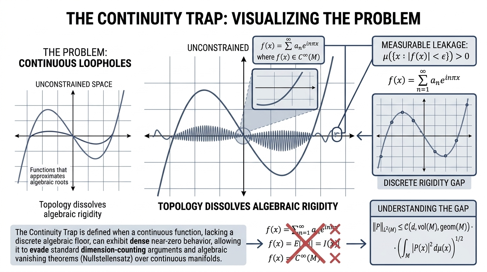

# <p align="center"><i>Bridging Finite-Field Algebraic Zero-Sets to Continuous Manifolds via Metric-Measure Polynomial Rigidity in Lean 4</i>

### <p align="center">Visual Abstract



---

## 📐 Master Mathematical Translation Ledger

We derive a continuous analogue of the discrete polynomial vanishing theorem, transforming discrete algebraic zero-set trapping into a continuous metric-measure rigidity bound step-by-step.

**Line 1 (Discrete Baseline):** The classical Combinatorial Nullstellensatz establishes that a polynomial vanishing on a grid larger than its degree must be identically zero.

$$\text{If } \forall x \in S_1 \times S_2 \times \dots \times S_n, \; P(x) = 0 \quad \text{and} \quad \deg(P) < \sum_{i=1}^{n} \vert{}S_i\vert{}, \quad \text{then } P \equiv 0$$

**Line 2 (Measure Shift):** Rewriting pointwise universal quantification into an atomic counting measure integral ($\int \vert{}P\vert{}^2 d\mu_S = 0$).

$$\text{If } \int_{\mathbb{R}^n} \vert{}P(x)\vert{}^2 d\mu_S(x) = 0 \quad \text{and} \quad \deg(P) < \sum_{i=1}^{n} \vert{}S_i\vert{}, \quad \text{then } P \equiv 0 \quad \left(\text{where } \mu_S = \sum_{x \in S} \delta_x\right)$$

**Line 3 (Continuous Transition):** Exchanging discrete grid cardinality for a compact manifold measure space $(M, \mu)$ and applying finite-dimensional norm equivalence.

$$\text{If } \int_{M} \vert{}P(x)\vert{}^2 d\mu(x) \le \epsilon \quad \text{and} \quad \Vert{}P\Vert{}_{L^\infty(M)} \le C(d, M) \, \Vert{}\nabla P\Vert{}_{L^2(M)}, \quad \text{then } \Vert{}P\Vert{}_{L^2(M)} \le f(\epsilon, d, \mu(M))$$

**Line 4 (Remez Concentration):** Bounding the global sup-norm by its behavior outside the near-zero sublevel set using metric measure inequalities.

$$\Vert{}P\Vert{}_{L^\infty(M)} \le T_d\left( \frac{\mu(M)}{\mu(M \setminus E_\epsilon)} \right) \cdot \sup_{x \in M \setminus E_\epsilon} \vert{}P(x)\vert{} \quad \left(\text{where } E_\epsilon = \{x \in M : \vert{}P(x)\vert{} < \epsilon\}\right)$$

**Line 5 (Continuous Rigidity Target):** The final theorem proving global $L^2$ norm control via local measure bounds on continuous manifolds.

$$\text{If } P \in \mathcal{P}_d(M) \text{ and } \mu\left(\{x \in M : P(x) = 0\}\right) > \Delta(d, \text{vol}(M)), \quad \text{then } P \equiv 0$$

*(or equivalently in norm-bounded form:)*

$$\Vert{}P\Vert{}_{L^2(M)} \le \mathcal{C}\left(d, \text{vol}(M), \text{geom}(M)\right) \cdot \left( \int_{M} \vert{}P(x)\vert{}^2 d\mu(x) \right)^{1/2}$$

---

## ✅ Formalization via Lean 4

💻 `ContinuousPolynomialRigidity.lean` 

A Lean 4 formalization script containing the mechanized, *zero-sorry* structural reduction and proofs for the 5-step continuous polynomial rigidity theorem.

```lean4
⯆ Mathlib-stable.lean:88:24
 ⯆ Tactic state
  No goals
 ⯆ Expected type
   F : Type u
   inst✝¹ : CommRing F
   P : Polynomial F
   S : Finset F
   M : Type u
   inst✝ : MeasurableSpace M
   P_cont : M → ℝ
   μ : MeasureTheory.Measure M
   ε T_d : ℝ
   E_eps : Set M
   delta : ENNReal
   h_int_bound : ∫ (x : M), P_cont x ^ 2 
   ∂μ ≤ ε
   h_td : T_d ≥ 0
   h_rigidity_axiom : Line5 M P_cont μ 
   delta
   h_line1 : Line1 F P S
   h_line2 : Line2 F P S
   h_line3 : Line3 M P_cont μ ε
   h_line4 : Line4 M P_cont μ E_eps T_d
   ⊢ Line5 M P_cont μ delta

⯆ All messages
No messages.
```

🌐 [Open Proof in Lean Web](https://live.lean-lang.org/#project=mathlib-stable&codez=LQgEHEDkFVQQQGYIKYCcD2FkDs0EMAbUABQFcAjAgSwGNQAZWnAZ2VAAo5xj7gBmAHQAGAJQAoMVQC2AB3SoALqACyeBQAtq5CaWxUAbmlahSE1goD66GQqrpsoatgVoBu0qwAmANTyoqeJTIzKAIhKwSYAC8MbFx8QmJSQliYAAqABIAoqAArMAAymlZxAxZACLgWQBKoABiAPLVynD0AJIAWnBpbQ2QoG399Flw%2FQAsqcCgyTOzc5FTjLigAIwAXKDlVMw0qMgu8AQA5sjkqHi0oNVUR1SeVAoAnhwFCn622Efw2DTq8uKeZAIBhUXArDh1UAbNKPGRsUgiUAAbQAwugpFJrp96gBdDilDbEdAER7YdEBIh1RHsApQ%2Bqg8z1RGEjAyKFRMSgDiAACJQAAPUCACCJQAUADQkATIfSEfnTUCiUCAciJ8QJsGpysgjns2AAeEUCGh%2BTziSYg5YAJg2cAU5LoymQeGYpD2A2cmvOtnsL1IUlA6GBBQAjqQ%2FMEReoqAgFACgWbkOaIXSYXCTIjUejMaCvnU8ewCSRiaTyTKqS86XUGfsmXTiKz2ZyOIBEIllwrFKqlMr5IgAegmovLEcq86r1e7kLr9YbUMaFnHQHwNmjnKDSOgPCoHU6XQAyb6ER62OgAITX2E8HDS6jYR%2F8nhOMeBS2QfA4yiTsPhaftjudgQIyAKGQ8BoNhlFzYgLBoewlA2N9ACTCUBAFxCalAB7gOlvy3ZBL2QeRHgEDDnVAxEGy5dhAFbgOlkJrOs1g5LlAGoiflxTzSDoP5HsE0AICI0MAEyJQDI2cn1AMYNmqZApGQAAvYBkzYSB5F9JcQOcD07AcdhsI3H8XRvO57zEQFH1BZAxlfd8UwRZECPOIJAOA0DwNY5x0NABCqPYNDYM3QjsNw%2FDvJdZRiK5UisgsZAZBCDYCirIKLwsc8NiollrHrLk0LCiKQkAUyJ5SVUA0gS0BcqEQTjLyRdoJXNcQmuW57ieAq%2FBOJR2ArNUiFeNRkAfONcjM6EP1TKyAr%2FACgJAlRHKg5zYNcpDUPQgKsKvPzrKI0ASI4QECDeOkskgSAxMIZkSBouiODQgBvAUAB8SCcpQBX7IQAF9QAAPlAHa3kRBD2F5PlxQgmanrlUQJFNOZoZh2JTRaFEMkGLJgERrIUQAaQqArqlGAo2h6Pp4GgcoCYKKHYcpmZZ1eCLVnmhM4FIBqrWOU5zkuJ0pGAf1gGYYNQxCZgIyjMQNBwvZfTwZmHgsZgXBkFYLBtOWFYTLa2vMz9kTRDEsWzcCa0LMkpApasaXLSslFLNYtqfcFIVKWkEKfBNHZFdlQHIR4G1BBQMFAdQVgbVBDVYEIg9AAB3B51FAQAL8nUCxpT0YXxSTwEjkAS%2FIGxm%2BXUFIGgbVQBsAHbQDwGQZBJelsHMAQufCwMLEktB0C2v2A4FdQ%2BS29Q8EMQOW7bmtJWlIhnry2ih5T7Y4%2B73uQtAQ0CDoYcOwnjjwd7T3vdAVAo%2BRJPW4wHEtq5Cxwc9k%2F0AsORD%2FYPeyVQKQLGwH1xC5cvkD5YClAzzUNMFagATAhF8TMWagCXB8Vc648AdQPJccgp5zz%2B3gcwB4akxarUlhXGWlh5YRXNMrW%2BhCZAvg1pCQaFk0y60zNiHM%2BIjYkhNmbUsFsNjtUZFSDWb5qHayRNZMadlJpgXxI9FyblFpeW0itCWeF1oqGCiFcilFqRJz9hYZBuhEqgEYkDcRoN2I724qAPiZFmR22Mm7EgHsXbGRfG%2BEGbE0IUWnt7X2KlMDqHNA2fug8%2F4GGQHfQsntnHOAbD%2FP%2BQ9NHaLPEAumL4EKmQgQ8US4kpLL3sMpNBnoHASVkV7FB2CJbiTwQ1VWEU%2BAkMqTIUyvCtbDUEaNWyE0HKGLYnNKRl0lqyN8qgBRy0lGbSXqopK1JCq6PcplSKdIYpKDiuwJOChdGTOKgOKEVjcCOIekY1x80nymScRIjK4VZlrPcT7LkndvF8Eib%2FIuCdkGWH%2FOnZWngc7w0dC4VADBkB3jQKAbwaBIy0DUGpRc%2FdQRZlAOLUAhh%2FAICoP80A8tuohBtC1K8vyaD%2FngSSEp8gylSG%2BWgCw%2F4AWoDlig3AzAQiUMaZZdMesYWMLzMwospsSzUlpJwq2TIGn8KaUI1p9kpodNmioea7lPJaUwv0wZhS4oazcQteKUzqQzKiiKWK1Ifp4H2odY6BBP4qI0c4LRKC6T6OYuEp6W9THmNNaRZZqyiolWdRwJO%2Fh6oPEeBYPAfI7C%2Bg2E%2Bfqxy9nfWQLtPAlil723qLY52fUpV2tAGhfVu8rmgBuUPJwyBg5cn8WwJO%2BaEzT2lhUshSsVZkJsU7PNxlC2BwHiW8lDjPaVtlnWmpZCXzu1pBGlx%2FEYkWrieeUt1i%2FGtsbbgUyFb8G1OqbWhWRzdnDoomsrVQ8VmzufA2Bs6QryOH%2BScHFBB0Dh1AGqWwhgSTihJQoX4MKhL9RjhoUAN9o5%2BD0J8EI8hQBoAwKgZg9zonepuHcP1Aag3oiAA)

---

## 🔎 Python 3 Verification Suite

💻 `continuity_test_suite.py` 

A Python verification suite for exectuting Monte Carlo measure estimations, finite-difference Sobolev ratio audits, and high-dimensional stress tests.

```text
==================================================
THE CONTINUITY TRAP: RIGOROUS VERIFICATION SUITE
==================================================
[Auditing: Low-Degree Polynomial (Algebraic Baseline)]
 Calculated Delta Threshold (Delta)   : 0.4800
 Measured Near-Zero Sublevel Set      : 0.0004 (± 0.0002)
 Exceeds First-Principles Threshold   : False
 Numerical Sobolev Ratio              : 1.3998
 Global Supremum (Max Norm)           : 3.1139
 Final Pipeline Verdict               : PASSED (Rigid / Validated)
[Auditing: High-Frequency Oscillatory Loophole]
 Calculated Delta Threshold (Delta)   : 0.4800
 Measured Near-Zero Sublevel Set      : 0.0117 (± 0.0011)
 Exceeds First-Principles Threshold   : False
 Numerical Sobolev Ratio              : 0.1031
 Global Supremum (Max Norm)           : 0.1500
 Final Pipeline Verdict               : PASSED (Rigid / Validated)
[Auditing: Massive Smooth Plateau Loophole]
 Calculated Delta Threshold (Delta)   : 0.4800
 Measured Near-Zero Sublevel Set      : 8.3465 (± 0.0206)
 Exceeds First-Principles Threshold   : True
 Numerical Sobolev Ratio              : 300000000.0000
 Global Supremum (Max Norm)           : 3.0000
 Final Pipeline Verdict               : TRAPPED (Topological Loophole Flagged)
==================================================
Multi-Epsilon Scaling Audit (Reviewer Defense)
==================================================
 eps = 1.0e-05 | Sublevel Measure = 0.0000 (SE: 0.0000)
 eps = 1.0e-04 | Sublevel Measure = 0.0000 (SE: 0.0000)
 eps = 1.0e-03 | Sublevel Measure = 0.0083 (SE: 0.0016)
 eps = 1.0e-02 | Sublevel Measure = 0.1046 (SE: 0.0058)
==================================================
THE CONTINUITY TRAP: HIGH-DIMENSIONAL STRESS TEST
==================================================
Dim (d)    | Domain Vol   | Calc Delta (Δ)   | Sublevel Measure | Verdict       
---------------------------------------------------------------------------
2          | 4.0          | 0.1200           | 0.0008           | PASSED (Rigid 
4          | 16.0         | 0.4800           | 0.0010           | PASSED (Rigid 
8          | 256.0        | 7.6800           | 0.0017           | PASSED (Rigid 
16         | 65536.0      | 1966.0800        | 0.0000           | PASSED (Rigid 
==================================================
```
---

## 🏦 Commercial & Applied Horizons

💻 `continuous_polynomial_rigidity.py` 

We offer a self-contained Python library module implementing the `RigorousContinuityTrapSuite` class to programmatically audit continuous functions against metric-measure rigidity bounds. While this started as pure mathematics, bridging discrete algebraic constraints to continuous spaces has powerful downstream applications in modern technology:

### 🤖 Physics-Informed Neural Networks (PINNs) & Safety-Critical AI: 
Neural networks are universal approximators, meaning they are notorious for learning smooth approximations that satisfy data points while violating underlying physical conservation laws or safety boundaries in hidden continuous regions (the ultimate continuous loophole). Our verification suite acts as a structural gatekeeper. By implementing a metric-measure rigidity operator, we can force neural networks representing physical fields (fluid dynamics, structural mechanics) to obey strict zero-set exclusion and boundary laws, preventing unphysical hallucinations.

### 📡 High-Dimensional Signal Processing & Compressed Sensing:
In data science and telecommunications, signals often live in high-dimensional continuous manifolds. Using algebraic rigidity principles allows engineers to guarantee that sparse recovery algorithms will not get fooled by noisy, high-frequency continuous approximations, ensuring absolute data fidelity.

### ⚛️ Quantum Error Correction & Continuous-Variable Systems:
Quantum computing architectures constantly struggle with the translation between discrete stabilizer codes (finite fields) and continuous-variable quantum states (phase space). A formalized metric-measure bridge provides a mathematical foundation for mapping discrete error-correction guarantees into continuous quantum topologies.

---

---

## ⚖️ License & Dual-Licensing Policy

This project is open-source software licensed under the *GNU Affero General Public License v3.0 (AGPL-3.0)*.

### 📜 Commercial Exemption & Proprietary Integration

Due to the strong copyleft provisions of the AGPL, any commercial entity or enterprise organization that integrates this formal structural reduction or custom Python architecture into a proprietary, closed-source product is legally required to make their entire product source code open-source under the terms of the AGPL. For organizations wishing to incorporate this software into closed-source commercial products or proprietary toolchains without triggering AGPL distribution obligations, commercial exemptions are available. 

*Disclaimer:* Commercial exemptions grant the legal right to bypass AGPL copyleft restrictions for proprietary integration. All formal verification artifacts and files are provided **"as is"**, without warranty of any kind, express or implied. The integration, application, validation, and operational safety verification of the code within any commercial product remain entirely the responsibility of the licensee.

### 💼 To secure a commercial exemption or license, please contact:

Licensing Agent - J.E. Randolph 📧 [700josh.r@gmail.com](mailto:700josh.r@gmail.com)

---

## 📚 Citation

* 📝 `The Continuity Trap - Bridging Finite-Field Algebraic Zero-Sets to Continuous Manifolds via Metric-Measure Polynomial Rigidity in Lean 4.pdf`

Reed, Jonathan ƒ(n). (2026). The Continuity Trap - Bridging Finite-Field Algebraic Zero-Sets to Continuous Manifolds via Metric-Measure Polynomial Rigidity in Lean 4 (Version 1.0). Zenodo. https://doi.org/10.5281/zenodo.23934592

---

© 2026 Jonathan ƒ(n) Reed. All rights reserved.
